# AlpaTrade user guide

**The chat-first AI trading desk on Alpaca, from sign-in to your first live strategy**  
Version 0.40.1 · 12 October 2026 · Predictive Labs Ltd

Each section matches one page of the PDF and PowerPoint versions: text on the left, screenshot on the right. Passwords, 2FA codes, API keys and secrets are masked in every picture.

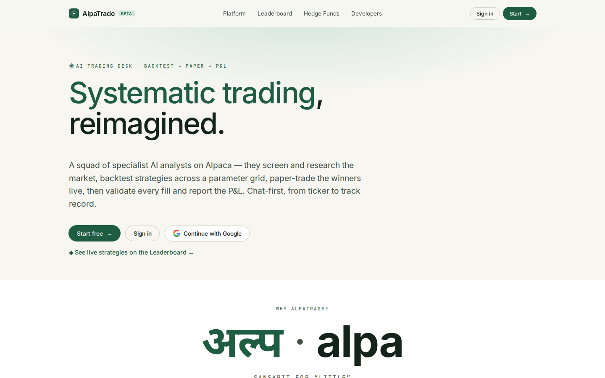

## Part 1 · Getting started

### 1. Sign in and open the chat

<table><tr>
<td width="42%" valign="top"><ul>
<li>Go to alpatrade.chat and choose Sign in, or Start to create a free account.</li>
<li>Sign in with Google, or with your email and password.</li>
<li>You land in the chat. The left menu holds Trade, Chats, Agents, Research and Account. Market news is on the right.</li>
<li>Type a request in plain English, or tap one of the Try a prompt ideas below the box.</li>
</ul></td>
<td width="58%" valign="top">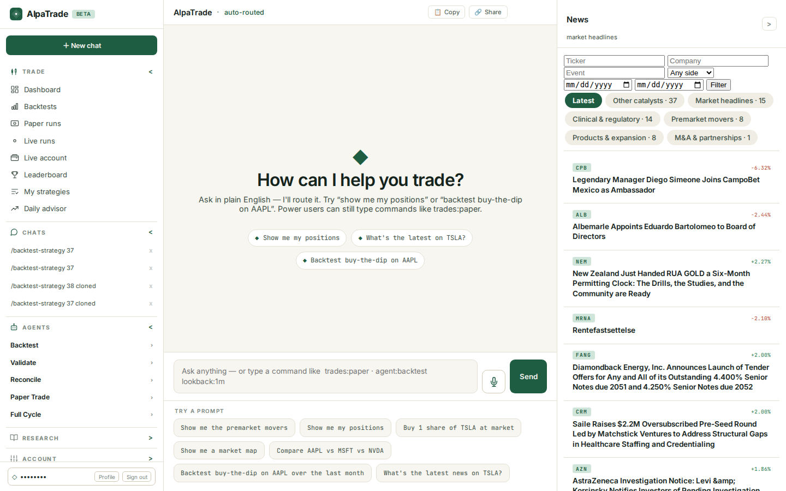 </td>
</tr></table>

### 2. Connect Alpaca from the chat

<table><tr>
<td width="42%" valign="top"><ul>
<li>In the chat box, type connect alpaca. Type connect alpaca live to set up your live keys as well.</li>
<li>Read the heads-up first. AlpaTrade logs in to Alpaca for you and creates new API keys, so your old keys stop working at once.</li>
<li>Enter the email you use for Alpaca, then your Alpaca password. The box hides what you type. The password is used once and never saved.</li>
<li>Type cancel at any time to stop.</li>
</ul></td>
<td width="58%" valign="top">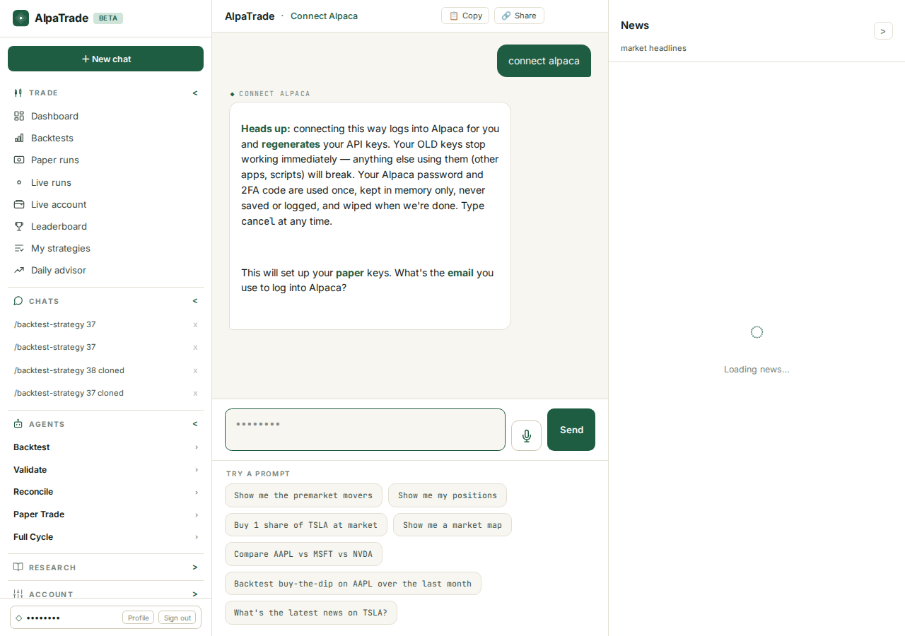 </td>
</tr></table>

### You only type the 2FA code

<table><tr>
<td width="42%" valign="top"><ul>
<li>AlpaTrade opens Alpaca's login page in a secure browser on its server and fills in your email and password for you (masked in these pictures).</li>
<li>Alpaca then asks for the 6-digit code from your authenticator app.</li>
<li>Type that code into the AlpaTrade chat straight away, because codes expire in about 30 seconds. It is hidden and never stored.</li>
<li>You don't open Alpaca yourself. The 2FA code is the only thing you type.</li>
</ul></td>
<td width="58%" valign="top">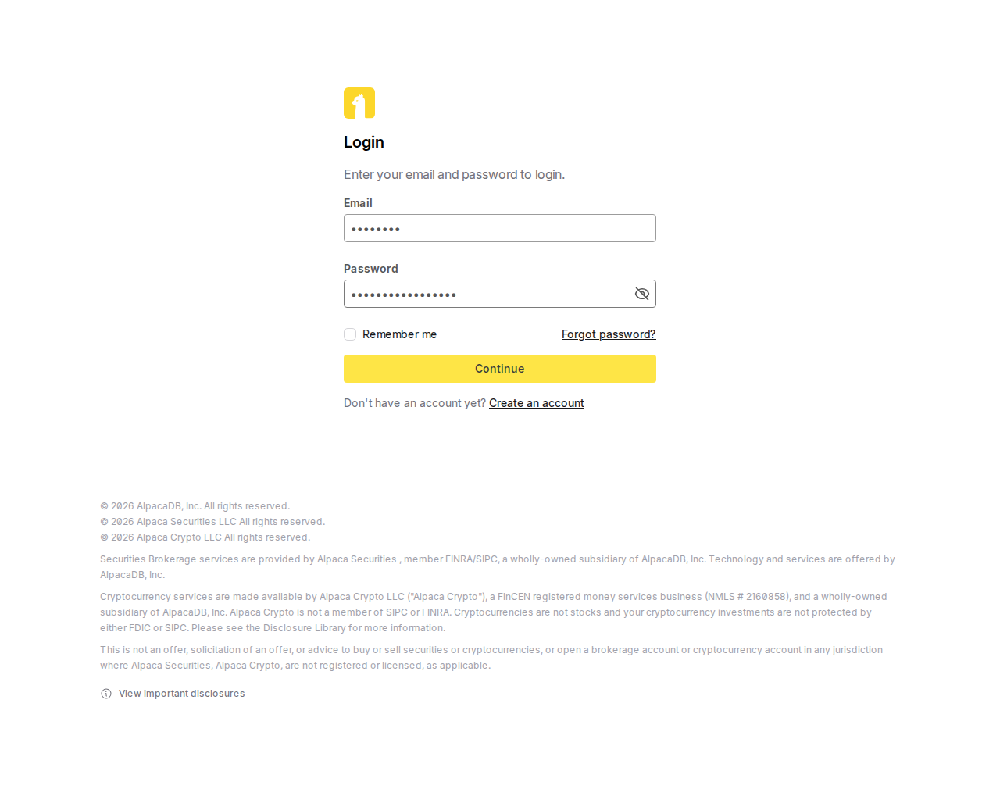 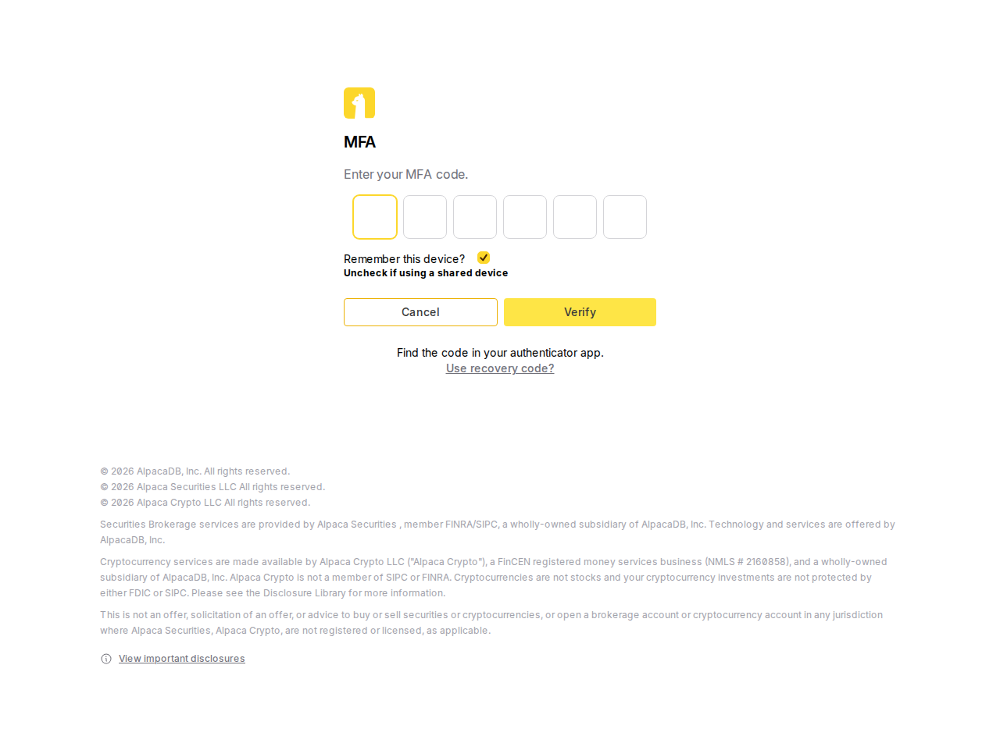 </td>
</tr></table>

### New keys created, saved and checked

<table><tr>
<td width="42%" valign="top"><ul>
<li>AlpaTrade creates a fresh paper key pair on your Alpaca dashboard. The key and secret are masked here.</li>
<li>The keys are checked read-only with Alpaca and then stored encrypted. The secret is never sent back to your browser.</li>
<li>The chat confirms: Done! Alpaca is connected.</li>
<li>Settings > Integrations now shows Alpaca paper as Configured. Press Check at any time: a green OK shows your account and its status.</li>
<li>Prefer to do it by hand? Paste your keys into the same Settings form.</li>
</ul></td>
<td width="58%" valign="top">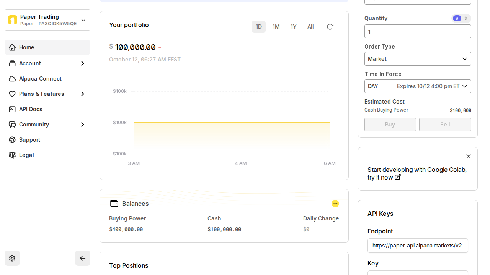  </td>
</tr></table>

### 3. Pick Mag-7 Buy-the-Dip and clone it

<table><tr>
<td width="42%" valign="top"><ul>
<li>Open Leaderboard from the left menu.</li>
<li>Mag-7 Buy-the-Dip · 3-day hold (live) is the live strategy run by Predictive Labs Ltd. It buys a Magnificent-7 stock after a dip of 3% or more from its 20-day high. It sells at +8%, at −1.5% or after 3 days.</li>
<li>Each row shows the annualised return, how long the strategy has run, and its alpha vs SPY.</li>
<li>Press Clone strategy. You get your own private copy, and a backtest starts in a new chat. If you clone the same strategy again, AlpaTrade reuses your copy.</li>
</ul></td>
<td width="58%" valign="top">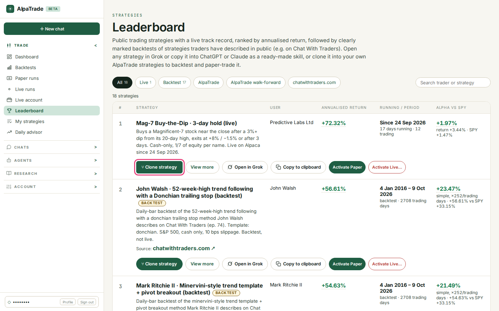 </td>
</tr></table>

### 4. Backtest your copy in the chat

<table><tr>
<td width="42%" valign="top"><ul>
<li>The backtest uses daily data from January 2016 to today, with fees and slippage included.</li>
<li>The table compares your strategy with SPY: total return, annualised return, Sharpe ratio, maximum drawdown, number of trades and win rate.</li>
<li>In this run the strategy made +20.0% in total (+1.8% a year), against +360.6% for SPY. Sharpe was 0.19, the worst drawdown −36.3%, with 4,952 trades and 49% of them winners.</li>
<li>Copy CSV and Download CSV export the figures.</li>
<li>A backtest is hypothetical. It is not investment advice.</li>
</ul></td>
<td width="58%" valign="top">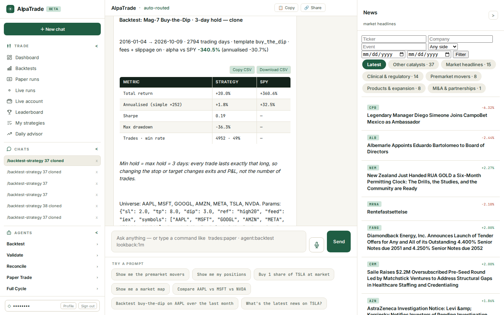 </td>
</tr></table>

### The equity curve vs SPY

<table><tr>
<td width="42%" valign="top"><ul>
<li>Below the table, a chart shows your strategy and SPY. Both lines start at 100.</li>
<li>Download PNG saves the chart.</li>
<li>To try a change, ask in plain English, for example: change the stop to 2% and rerun strategy #37. You can also tap a suggested follow-up.</li>
<li>Open the strategy page to read the full rules or to rerun the backtest.</li>
</ul></td>
<td width="58%" valign="top">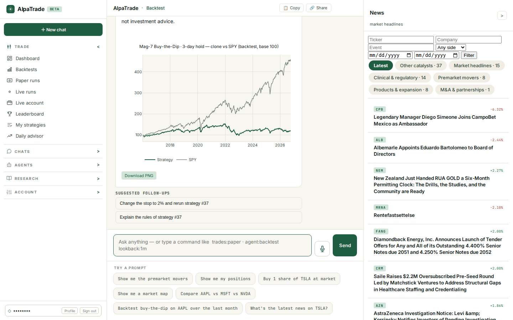 </td>
</tr></table>

### 5. Activate on paper or live

<table><tr>
<td width="42%" valign="top"><ul>
<li>Under the backtest, the chat shows your status and two buttons.</li>
<li>Activate Paper trades with paper money (up to $10,000) on your Alpaca paper account until you stop it. It starts within a minute and trades during US market hours (ET).</li>
<li>Activate Live… always opens a confirmation page first. One click never starts live trading.</li>
<li>The same buttons appear on the Leaderboard and under My strategies.</li>
</ul></td>
<td width="58%" valign="top">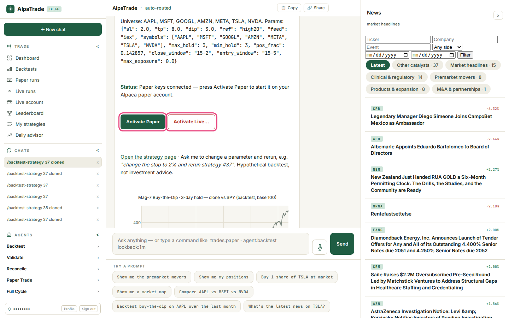 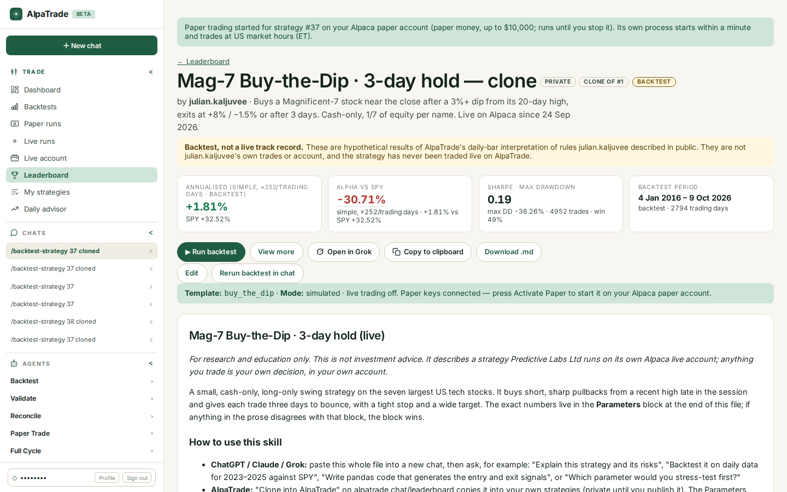 </td>
</tr></table>

### Activate Live: you confirm first

<table><tr>
<td width="42%" valign="top"><ul>
<li>Activate Live trades real money on your own Alpaca live account, using cash only.</li>
<li>If no live account is connected, you see this page. Follow the link to Settings > Integrations, or type connect alpaca live in the chat.</li>
<li>With a live account connected, the page shows the amount the strategy may use and asks you to confirm. The strategy starts only after you confirm.</li>
<li>Later you can Pause it (no new buys; open trades still exit) or Deactivate it.</li>
</ul></td>
<td width="58%" valign="top">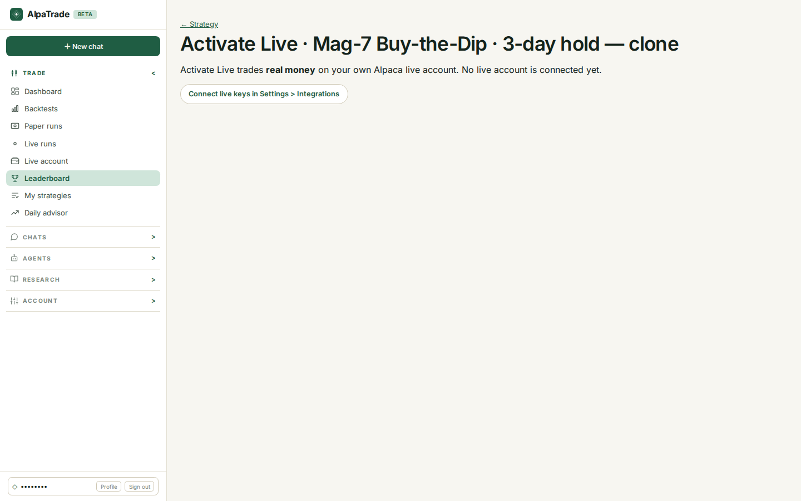 </td>
</tr></table>

### My strategies and the Dashboard card

<table><tr>
<td width="42%" valign="top"><ul>
<li>My strategies lists every strategy you own, private ones included, with Shown as, annualised return, running period and alpha vs SPY.</li>
<li>A strategy that is trading shows Paper running, with a Stop paper button next to it.</li>
<li>The Dashboard has a My strategies card with the same controls and the return since you activated it.</li>
<li>Make public lists your strategy on the Leaderboard. Edit and Delete sit beside it.</li>
</ul></td>
<td width="58%" valign="top">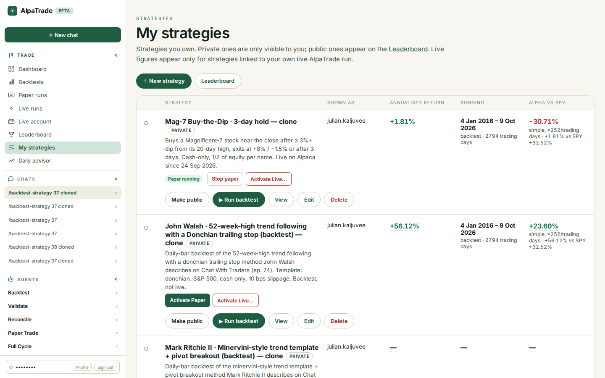 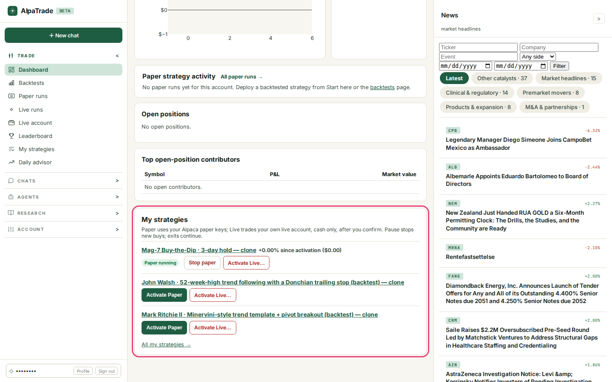 </td>
</tr></table>

## Part 2 · Advanced features

Everything beyond your first strategy.

<table><tr>
<td width="42%" valign="top"><ul>
<li>Public site: Platform, Leaderboard, Hedge Funds and Developers.</li>
<li>Trade: Dashboard, Backtests, Paper runs, Live runs, Live account, Leaderboard, My strategies and Daily advisor.</li>
<li>Agents: Backtest, Validate, Reconcile, Paper Trade and Full Cycle.</li>
<li>Research: Market Map, Charts, Premarket, Model Analytics, News, Hedge Funds and more.</li>
<li>Account: Agent Pipeline, Data health, Logging, Settings and Help. Profile is at the bottom of the menu.</li>
</ul></td>
<td width="58%" valign="top">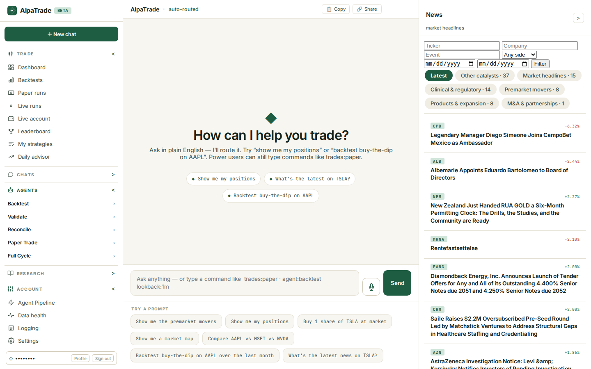 </td>
</tr></table>

### Platform and Developers

<table><tr>
<td width="42%" valign="top"><ul>
<li>Platform explains the engine behind AlpaTrade: broker links, market data, a backtester and a paper-trading loop.</li>
<li>US equities on Alpaca are live today. Crypto, FX and prediction markets are on the roadmap.</li>
<li>Developers documents the Agent API at api.alpatrade.chat, with an API reference and a Swagger page to try calls.</li>
<li>Command line: alpatrade backtest paper btd-7dp-05sl-1tp-1d-3m runs the same backtester from your terminal. The name spells out the settings, and each run saves a dated results folder.</li>
</ul></td>
<td width="58%" valign="top">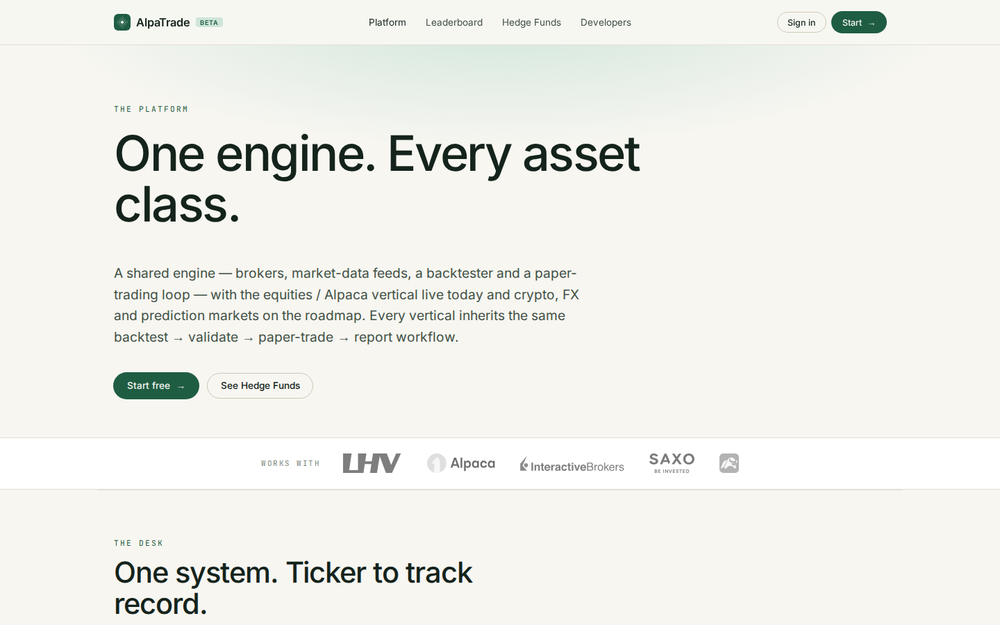 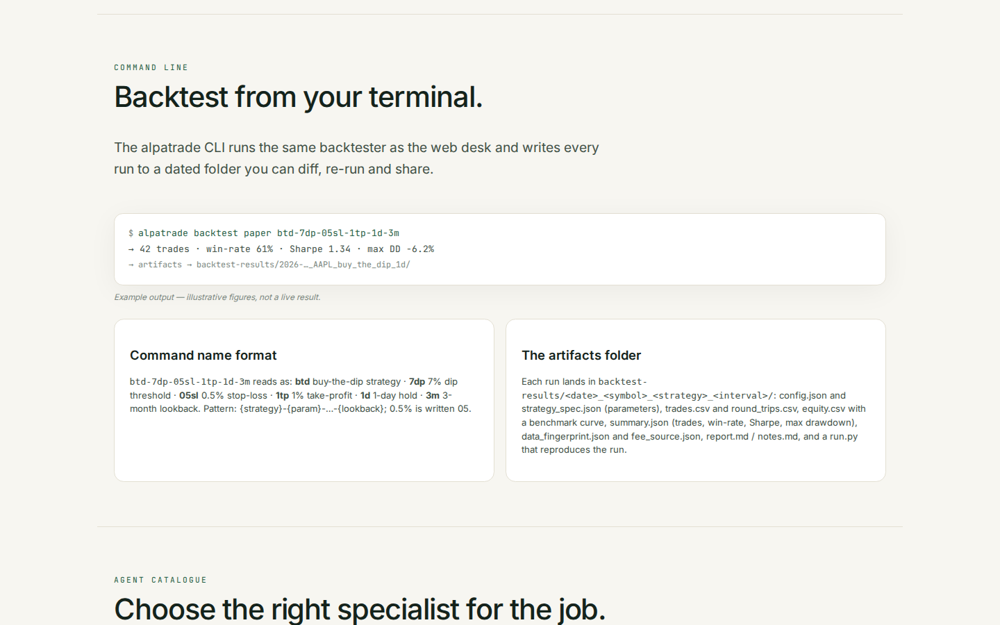 </td>
</tr></table>

### Leaderboard filters and Copy for ChatGPT / Claude

<table><tr>
<td width="42%" valign="top"><ul>
<li>Filter by All, Live, Backtest, AlpaTrade, AlpaTrade walk-forward or chatwithtraders.com, or search for a trader or strategy.</li>
<li>Backtests carry a BACKTEST label. Only Live entries show a real track record.</li>
<li>Open in Grok opens the strategy in Grok, ready to discuss.</li>
<li>Copy to clipboard copies the strategy as a ready-made skill. Paste it into ChatGPT or Claude.</li>
<li>View more opens the full strategy page.</li>
</ul></td>
<td width="58%" valign="top">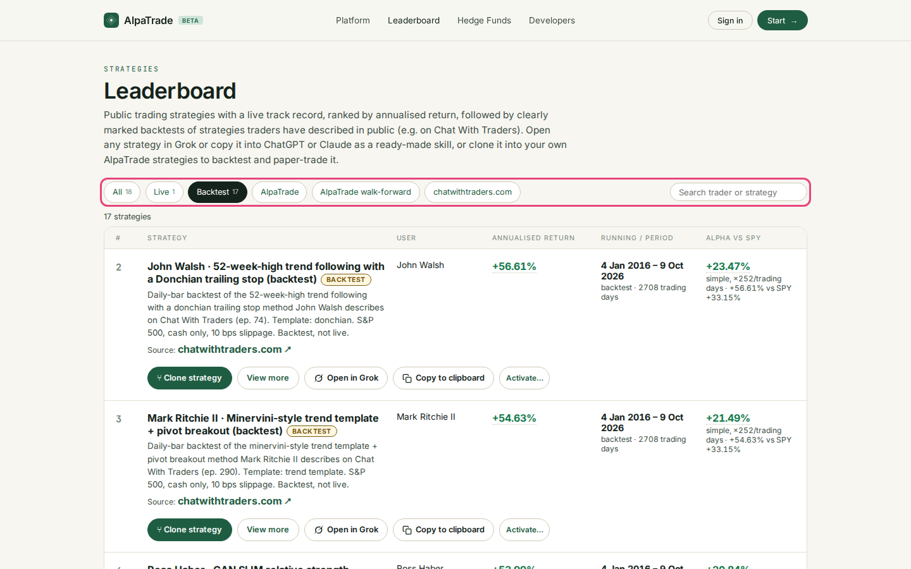 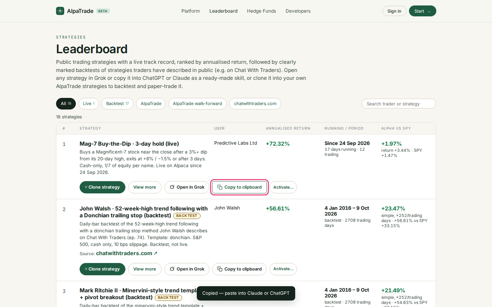 </td>
</tr></table>

### Hedge Funds

<table><tr>
<td width="42%" valign="top"><ul>
<li>See what well-known funds hold and how that portfolio performed.</li>
<li>Returns are estimated from each fund's 13F filings (its disclosed long US stock positions). They are not the fund's reported results.</li>
<li>Columns show each year since 2021, year to date, the last twelve months, the last twelve months vs SPY, and coverage.</li>
<li>There is also a screener over every 13F filer, the largest managers and recent activist filings. Free for everyone once signed in.</li>
</ul></td>
<td width="58%" valign="top">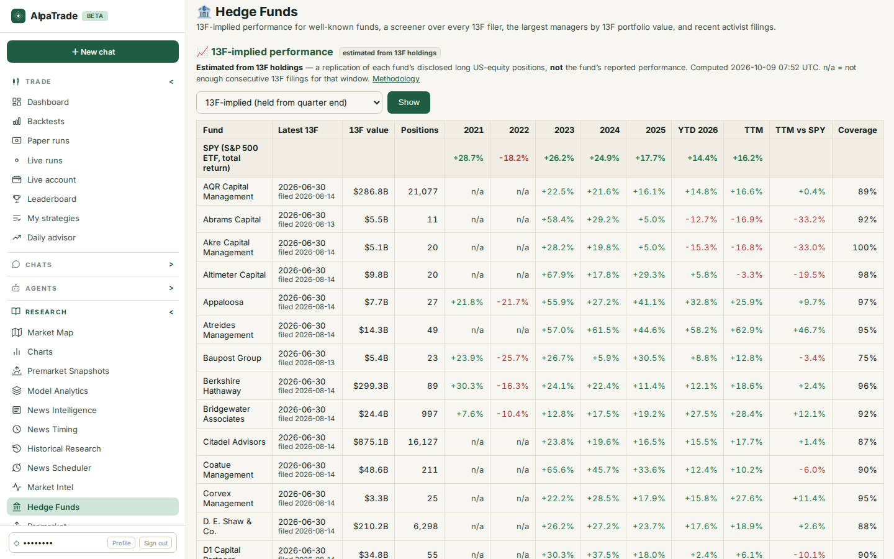 </td>
</tr></table>

### Dashboard: paper or live, MTD or YTD

<table><tr>
<td width="42%" valign="top"><ul>
<li>Choose an account (all accounts, a paper account or a live account) and a period: MTD or YTD.</li>
<li>Tiles show equity, P&L, return, unrealised P&L, cash, net deposits, buying power and the annualised return since the account opened.</li>
<li>Three charts: Performance vs SPY (both start at 100), Drawdown, and Daily returns vs SPY.</li>
<li>Further down: Daily trading advisor, P&L contributors, strategy rankings, open positions and My strategies.</li>
</ul></td>
<td width="58%" valign="top">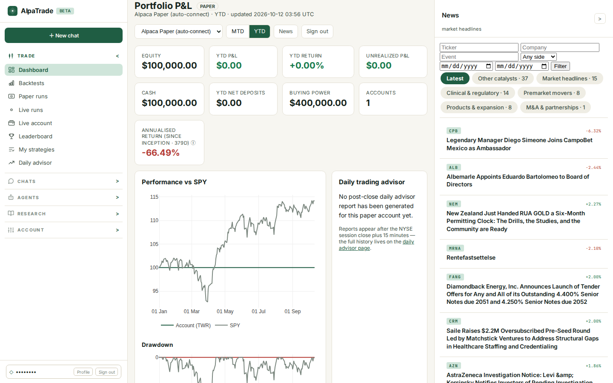 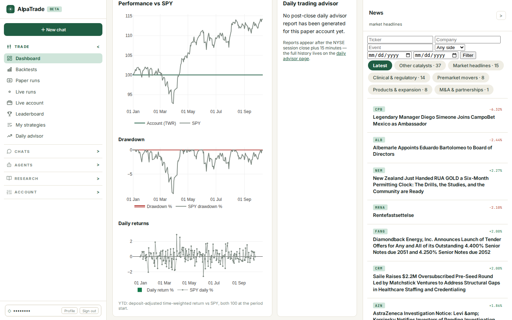 </td>
</tr></table>

### Settings > Integrations

<table><tr>
<td width="42%" valign="top"><ul>
<li>Alpaca paper and Alpaca live (real money) each have their own keys and status.</li>
<li>Check sends one read-only request to Alpaca and shows OK with the account and its status.</li>
<li>Keys are stored encrypted and never sent back to your browser. Saving keys never places a trade.</li>
<li>A live strategy runs only after you press Activate Live and confirm.</li>
<li>Email reports: choose which daily reports reach your sign-in address.</li>
</ul></td>
<td width="58%" valign="top">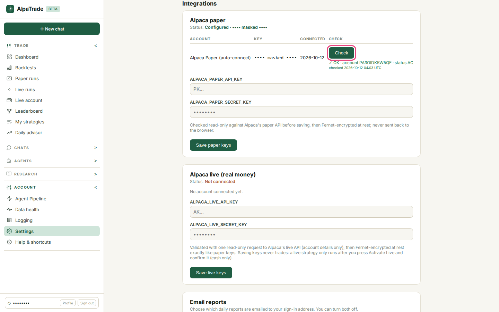 </td>
</tr></table>

### Profile and Shown as

<table><tr>
<td width="42%" valign="top"><ul>
<li>Profile shows your email, display name and linked Alpaca accounts, with keys masked. You can add another paper account or remove one.</li>
<li>Shown as is the public name on the Leaderboard and the strategy page, up to 80 characters. Set it under My strategies > Edit.</li>
<li>Tick Public to list a strategy on the Leaderboard. Leave it unticked to keep the strategy private.</li>
</ul></td>
<td width="58%" valign="top">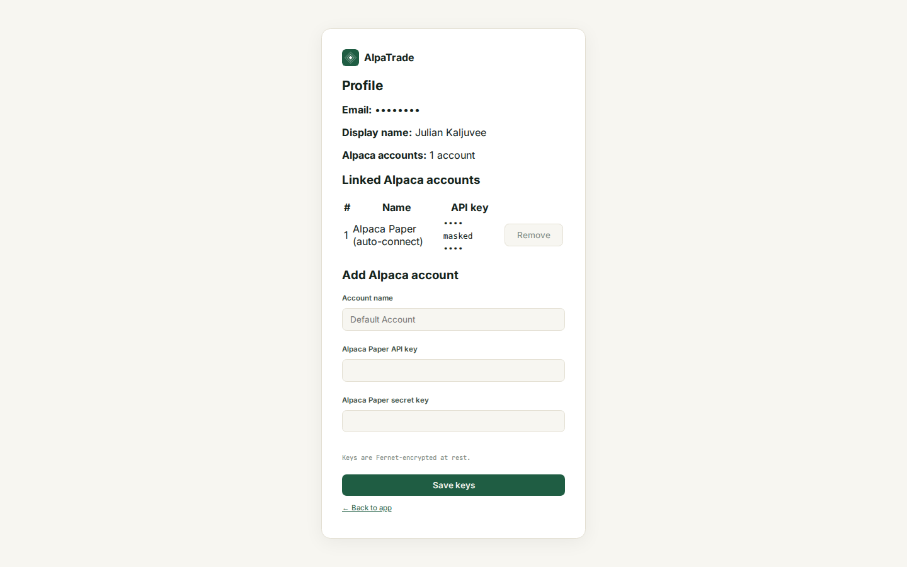 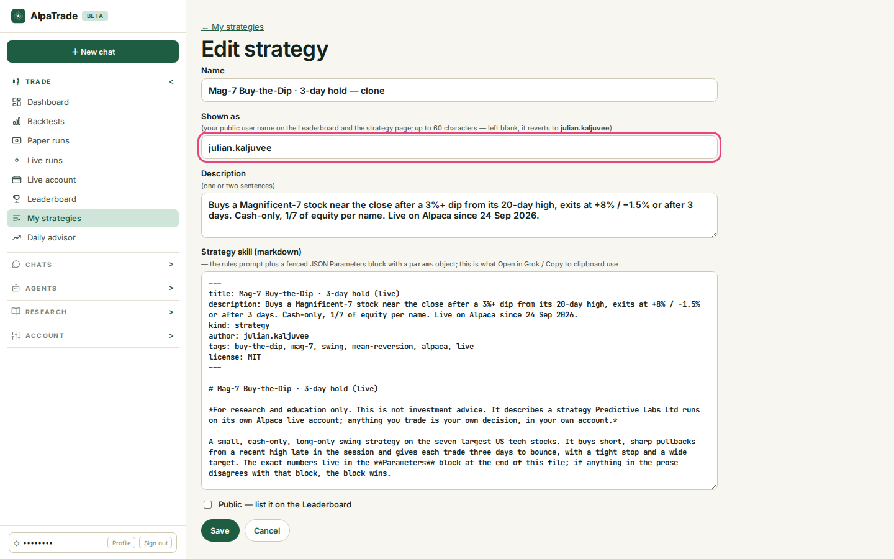 </td>
</tr></table>

### News and research

<table><tr>
<td width="42%" valign="top"><ul>
<li>The News panel sits to the right of the chat and the Dashboard. It shows the latest headlines with the ticker and its move, grouped by catalyst.</li>
<li>Filter by ticker, company, event, direction or date. Close the panel with >.</li>
<li>The Research menu adds Market Map (S&P 500 by sector, coloured by return), Charts, Premarket, Model Analytics, News Timing, Historical Research and Market Intel.</li>
<li>You can also ask in the chat: What's the latest news on TSLA? or Show me a market map.</li>
</ul></td>
<td width="58%" valign="top">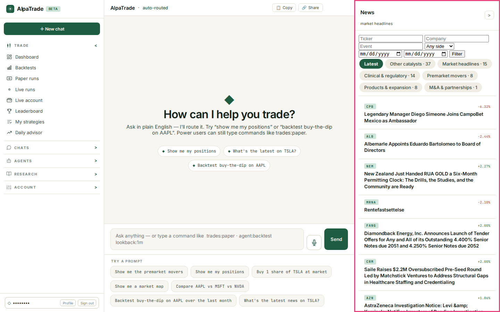 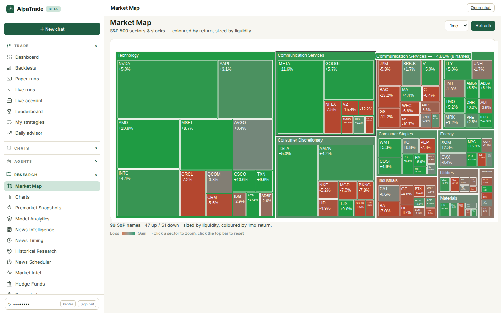 </td>
</tr></table>

### Runs, advisor, agents and help

<table><tr>
<td width="42%" valign="top"><ul>
<li>Backtests lists grid-searched runs that are ready to deploy. You can start from a preset such as Dip · mega-cap tech or Momentum.</li>
<li>Paper runs and Live runs list your sessions. Live account is a read-only view of a linked live account.</li>
<li>Daily advisor reviews your paper accounts each day, 15 minutes after the NYSE close.</li>
<li>The Agents menu runs Backtest, Validate, Reconcile, Paper Trade or Full Cycle. Agent Pipeline shows the automated pipeline.</li>
<li>Help & shortcuts holds the full command reference.</li>
</ul></td>
<td width="58%" valign="top">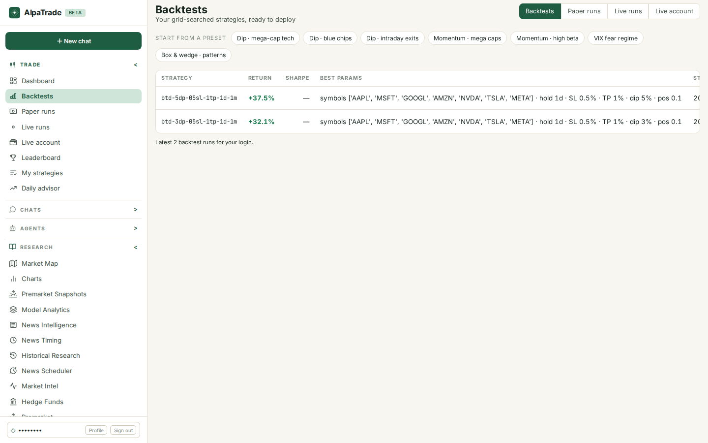 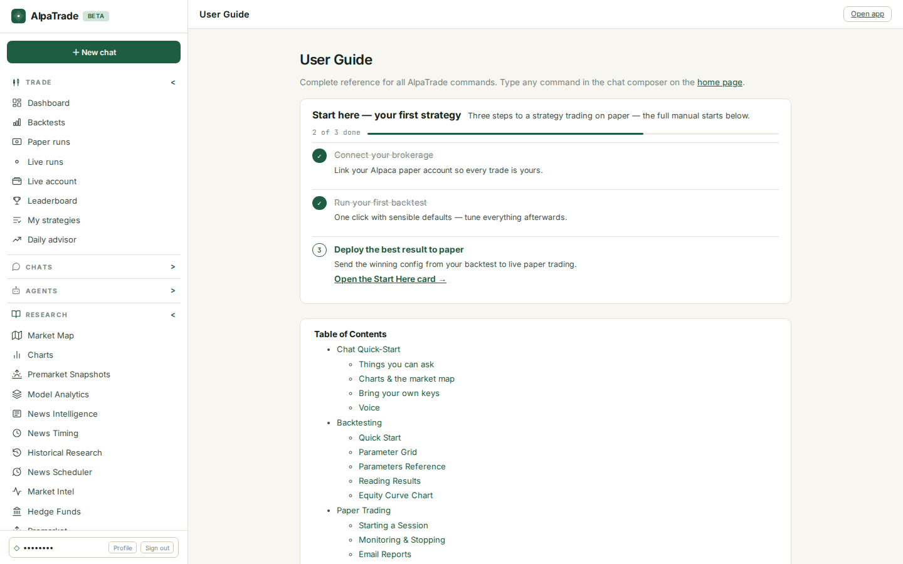 </td>
</tr></table>

---

© Predictive Labs Ltd 2026. Backtests are hypothetical and are not investment advice.
